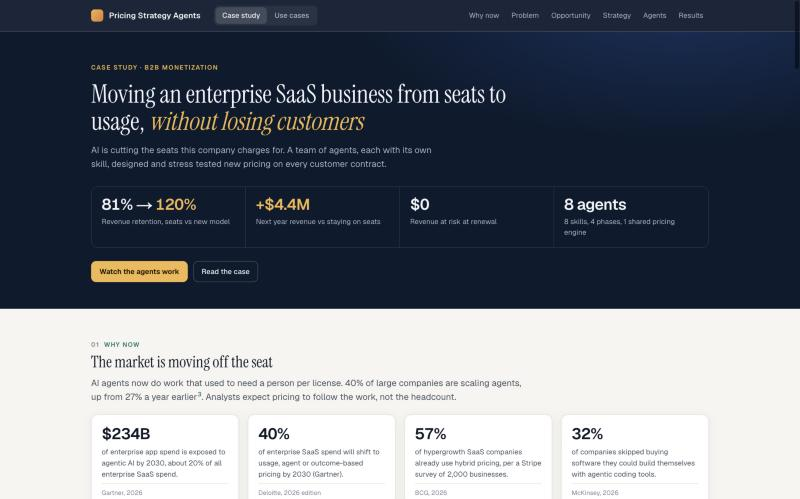
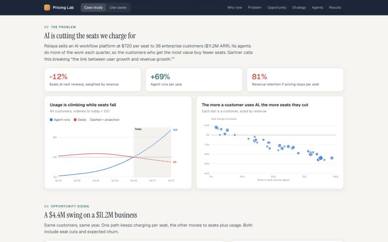
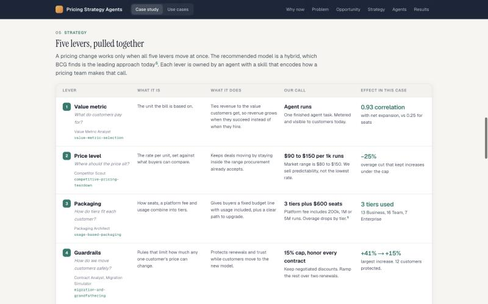
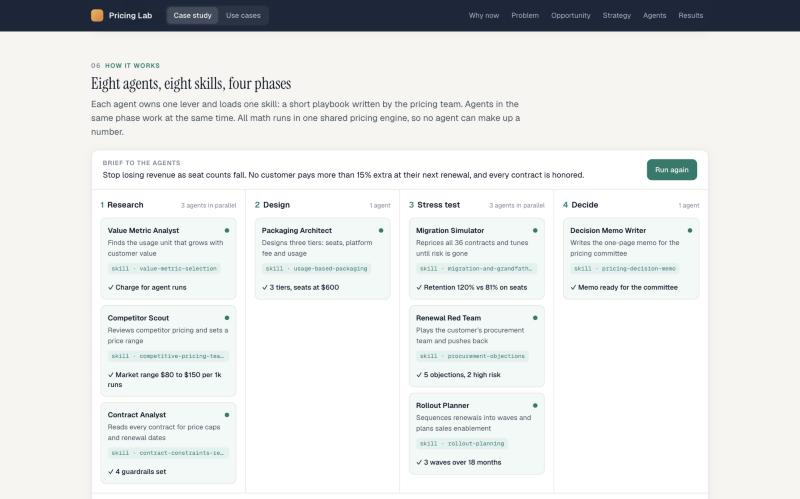
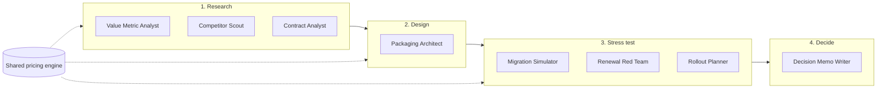
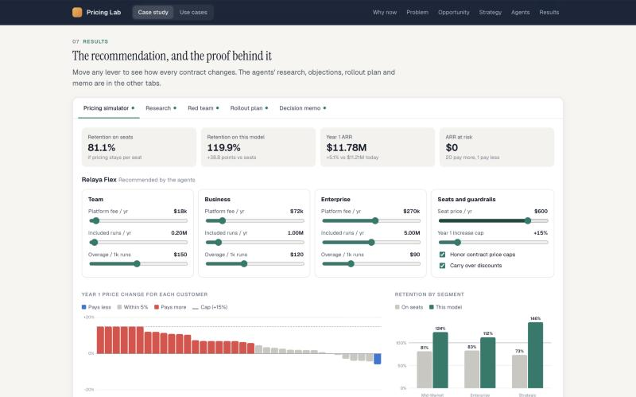
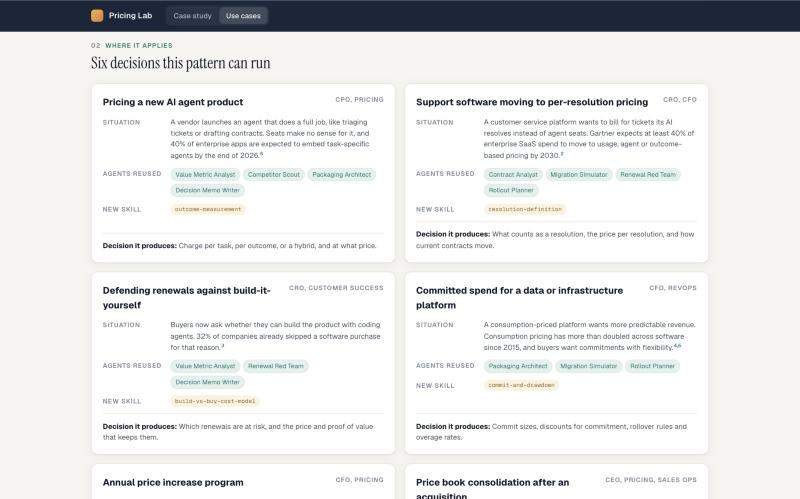

# Seat-to-Usage Pricing Lab

**How an enterprise SaaS company moves from per-seat to usage pricing without losing customers. Eight agents, each with its own skill, research the market, design the new model, stress test it on every contract and write the decision memo.**



| Revenue retention | Next year revenue | Revenue at risk | Largest increase at renewal |
|:---:|:---:|:---:|:---:|
| **81% → 120%** | **+$4.4M** on an $11.2M base | **$0** | **15%**, capped |

---

## Executive summary

AI agents are doing work that used to need a person on a license. Customers who get the most value from an AI product now buy fewer seats, so per-seat revenue shrinks exactly where the product works best.

This project is a working case study of the fix. A fictional company, Relaya, has 36 enterprise customers and $11.2M in ARR. On seats, revenue retention falls to 81%. The agents recommend a hybrid model, seats plus metered agent runs, that lifts retention to 120% while honoring every existing contract and capping any single customer's increase at 15%.

The output is what a pricing committee needs to say yes: a model, the evidence behind it, the objections procurement will raise, a rollout plan and a one-page memo.

## 1. Why now

| Signal | Source |
|---|---|
| Up to **$234B** of enterprise application spend, about 20% of enterprise SaaS spend, is exposed to agentic AI by 2030 | [Gartner, July 2026](https://www.gartner.com/en/newsroom/press-releases/2026-07-01-gartner-says-us-dollars-234-billion-in-enterprise-application-software-spend-is-at-risk-from-agentic-artificial-intelligence) |
| At least **40%** of enterprise SaaS spend shifts to usage, agent or outcome-based pricing by 2030 | Gartner, cited in [Deloitte TMT Predictions 2026](https://www.deloitte.com/us/en/insights/industry/technology/technology-media-and-telecom-predictions/2026/saas-ai-agents.html) |
| **40%** of large organizations are scaling agents, up from 27% a year earlier | [McKinsey, The State of AI, August 2026](https://www.mckinsey.com/capabilities/quantumblack/our-insights/the-state-of-ai) |
| **32%** of companies skipped buying software they could build with agentic coding tools | [McKinsey, The State of AI, August 2026](https://www.mckinsey.com/capabilities/quantumblack/our-insights/the-state-of-ai) |
| **57%** of hypergrowth SaaS companies already use hybrid pricing, and buyers want a predictable bill | [BCG, 2026](https://www.bcg.com/publications/2026/saas-pricing-must-change-agentic-ai) |
| Companies using consumption pricing **more than doubled** from 2015 to 2024 | [McKinsey, January 2026](https://www.mckinsey.com/featured-insights/week-in-charts/ai-adjusts-the-software-bill) |

## 2. The problem



- **Seats are falling.** Seats at Relaya's next renewals are down 12%, weighted by revenue.
- **Usage is rising.** Agent runs are growing 69% a year.
- **The two move against each other.** The more of a customer's work agents do, the more seats that customer cuts.
- **Revenue follows the seats.** If pricing stays per seat, revenue retention drops to 81%.

## 3. The opportunity

Moving to seats plus usage takes revenue retention from 81% to 120%. That is a **$4.4M swing in next year's revenue from the same customers**, about 39% of ARR.

| Bridge to next year revenue | |
|---|---:|
| Seats at renewal | $9.09M |
| Repricing to the new model | +$1.90M |
| Usage growth | +$2.80M |
| Expected churn | −$0.33M |
| **Next year revenue on the new model** | **$13.44M** |

A company with $100M ARR and the same mix would see roughly $39M a year.

## 4. Why this is hard

- **Contracts limit the move.** 10 of the 36 contracts cap renewal increases at 7%.
- **Buyers need a predictable bill.** Pure usage pricing loses enterprise budgets.
- **A naive model hurts the best customers.** An untuned model raises prices most for the heaviest AI users. Before tuning, the largest increase is 41%.

## 5. Strategy: five levers



| Lever | What it is | What it does | Our call | Owner (skill) |
|---|---|---|---|---|
| **Value metric** | The unit the bill is based on | Ties revenue to the value customers get, so revenue grows when they succeed | Agent runs. Correlates 0.93 with net expansion, against 0.25 for seats | Value Metric Analyst (`value-metric-selection`) |
| **Price level** | The rate per unit, set against what buyers can compare | Keeps deals inside the range procurement already accepts | $90 to $150 per 1,000 runs, inside a market range of $80 to $150 | Competitor Scout (`competitive-pricing-teardown`) |
| **Packaging** | How seats, a platform fee and usage combine into tiers | Gives buyers a fixed budget line with usage included and a clear path to upgrade | Three tiers plus $600 seats. Overage drops by tier | Packaging Architect (`usage-based-packaging`) |
| **Guardrails** | Rules that limit how much any one customer's price can change | Protects renewals and trust while customers move | 15% cap, every contract honored, discounts kept. Largest increase falls from 41% to 15% | Contract Analyst, Migration Simulator (`contract-constraints-review`, `migration-and-grandfathering`) |
| **Sales motion** | The order customers move in and what sales needs to sell it | Puts low-risk renewals first so the team learns before large accounts renew | Three waves over 18 months, 120 day notice, executive calls for increases above 10% | Renewal Red Team, Rollout Planner (`procurement-objections`, `rollout-planning`) |

## 6. How it works



Eight agents work in four phases. Agents in the same phase run at the same time.



| Design choice | Why it matters |
|---|---|
| **One skill per agent.** Skills are plain-text playbooks in [skills/](skills/), loaded with a `load_skill` tool. | The pricing team can change how a call is made without touching code. |
| **Agents act through tools.** They read contracts, test value metrics and reprice every account, then finish by calling a `submit_*` tool. | Every output is structured and can be checked. |
| **All math runs in one engine** ([src/lib/pricing.ts](src/lib/pricing.ts)). | Agents never calculate revenue themselves, and the simulator on screen shows the same numbers the agents saw. |
| **Orchestration is plain code** ([src/lib/agents/pipeline.ts](src/lib/agents/pipeline.ts)). | Each agent gets only the context it needs, and parallel phases cut run time. |

## 7. Results



| | Seats today | Recommended model |
|---|---:|---:|
| Revenue retention | 81% | 120% |
| Next year revenue | $9.1M | $13.4M |
| Largest increase at renewal | n/a | 15%, capped |
| Revenue at risk | n/a | $0 |

The results section of the app includes:

- **Pricing simulator.** Move any lever and see every contract reprice live.
- **Research.** The value metric analysis, competitor teardown and contract review.
- **Red team.** The objections procurement will raise, ranked by risk, with responses.
- **Rollout plan.** Three waves of renewals with sales enablement for each.
- **Decision memo.** A one-page recommendation for the pricing committee.

## 8. Where else this applies



The same agents, skills and engine fit any B2B pricing decision that touches existing contracts. Change the data and a skill or two, and the rest carries over.

| Decision | Who owns it | New skill needed |
|---|---|---|
| Pricing a new AI agent product | CPO, Pricing | `outcome-measurement` |
| Moving support software to per-resolution pricing | CRO, CFO | `resolution-definition` |
| Defending renewals against build-it-yourself | CRO, Customer Success | `build-vs-buy-cost-model` |
| Committed spend for a data or infrastructure platform | CFO, RevOps | `commit-and-drawdown` |
| An annual price increase program | CFO, Pricing | `value-based-uplift` |
| Price book consolidation after an acquisition | CEO, Pricing, Sales Ops | `sku-mapping` |

## Run it locally

```bash
npm install
npm run dev
```

Open http://localhost:3000 and click **Run the agents**.

- **Replay** (default) plays back a recorded run with the real timing of the parallel agents. Every number comes from the real engine.
- **Live** runs the agents on the Claude API (`claude-opus-5-5` with tool use). Copy `.env.example` to `.env.local` and add an `ANTHROPIC_API_KEY`, and a Live toggle appears.

## Project structure

```
skills/                 One playbook per agent (SKILL.md)
src/lib/data.ts         Synthetic customers, contracts and competitors
src/lib/pricing.ts      Pricing engine shared by agents and UI
src/lib/analytics.ts    Value metric, contract and renewal analysis
src/lib/agents/         Tool definitions, agent loop, phase orchestration
src/lib/demo.ts         Recorded replay of a full run
src/components/         Case study, agent board, charts, simulator, use cases
src/app/api/            Server-sent events for live and replay runs
```

**Stack:** Next.js 15, TypeScript, the Anthropic TypeScript SDK, server-sent events and hand-built SVG charts.

## Data and sources

Relaya, its customers and its competitors are fictional, and all company data is synthetic. Market figures come from the public 2026 research linked above.

## Usage and contributions

Copyright © 2026. All rights reserved. See [LICENSE](LICENSE).

This repository is public to view, not to reuse. To use any part of it, open an issue asking for permission. Pull requests are welcome but are reviewed and merged only by the owner.
